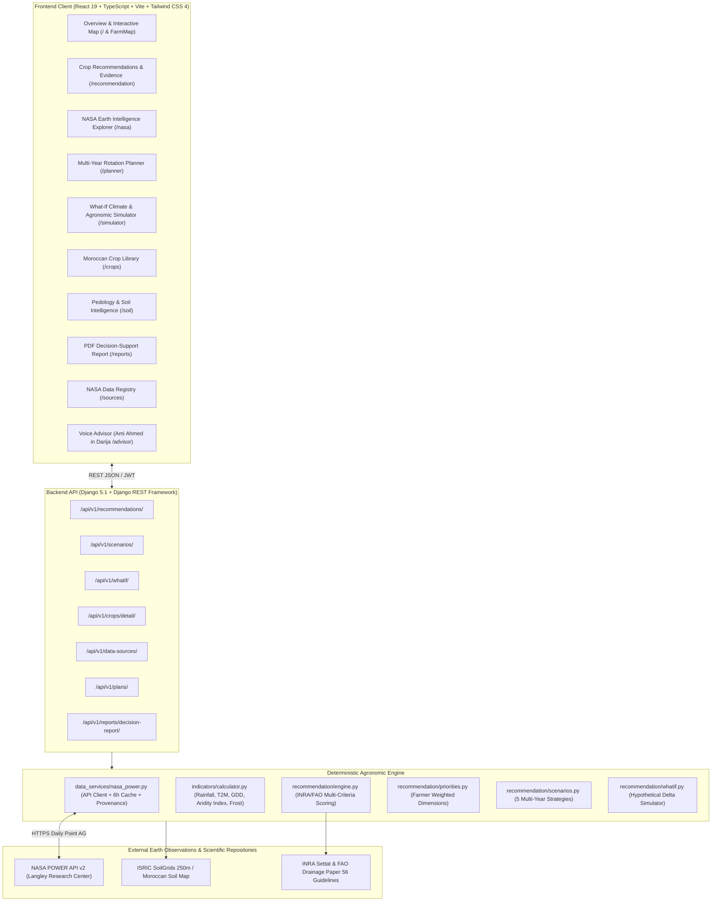

# TERRAROTA 🌱
> **NASA Space Apps Challenge 2026 • Challenge: Field Shift — Adapting Farms with NASA Data**  
> **Geographic Focus: Kingdom of Morocco**  
> *"Terrarota transforms NASA Earth observation data, local soil information, crop characteristics, and farmer priorities into explainable crop-rotation strategies that support climate-resilient and sustainable agriculture in Morocco."*

---

## 🌟 Executive Summary

Moroccan agriculture is facing unprecedented interconnected challenges: recurring droughts, irregular rainfall, declining groundwater tables, and severe soil degradation caused by continuous cereal monoculture. Smallholder farmers often make planting decisions without access to consolidated climate and soil intelligence.

**Terrarota** bridges the gap from Earth observations to practical on-the-ground farming decisions by combining four pillars:
1. **NASA Earth Observations**: Live agroclimatology from the NASA POWER project (Langley Research Center), covering precipitation (`PRECTOTCORR`), temperatures (`T2M`, `T2M_MAX`, `T2M_MIN`), Growing Degree Days (`GDD`), and UNEP Aridity Index over a 5-year climatological window.
2. **Moroccan Soil Intelligence**: Classification of Moroccan pedological classes (**Tirs**, **Hamri**, **Rmel**, **Dahra**) cross-referenced with ISRIC SoilGrids 250m digital soil models.
3. **Scientific Agronomic Rules**: Homologated crop rotation guidelines from **INRA Maroc** (Institut National de la Recherche Agronomique), **ICARDA**, and **FAO**, quantifying biological nitrogen fixation (40 to 100 kg N/ha) by food legumes following cereals.
4. **Farmer-Controlled Decision Support**: A deterministic recommendation engine that proposes multi-year rotation scenarios, provides What-If simulation capabilities, and generates downloadable agricultural decision reports in Arabic, French, and English.

---

## 🏛️ System Architecture



---

## 🛰️ NASA Earth Observation Integration

TerraRota does not merely display static logos; NASA data plays a genuine, operational role in every agricultural recommendation:

| NASA Product / Parameter | Code | Role in TerraRota | Agronomic Threshold Applied |
|---|:---:|---|---|
| **Corrected Precipitation** | `PRECTOTCORR` | Multi-year annual rainfall climatology & seasonal distribution | Cereal viability (>300 mm), Legume flowering (>250 mm), Aridity classification |
| **Mean Air Temperature (2m)** | `T2M` | Base temperature for growth & biological activity | Evapotranspiration estimation & heat tolerance screening |
| **Temperature Extremes** | `T2M_MAX`, `T2M_MIN` | Frost-risk evaluation & heat stress detection | Days with $T_{min} < 0^\circ\text{C}$ to alert early flowering legumes (chickpea/almond) |
| **Growing Degree Days** | `GDD Base 10°C` | Phenological maturity accumulation | Hard wheat ($\ge 1200$ GDD), Soft wheat ($\ge 1100$ GDD), Tomato ($\ge 1800$ GDD) |
| **UNEP Aridity Index** | `P / PET` | Ratio of precipitation to Thornthwaite potential evapotranspiration | Hyper-arid ($<0.05$), Arid ($0.05-0.2$), Semi-Arid ($0.2-0.5$), Sub-Humid ($>0.5$) |
| **Solar Radiation** | `ALLSKY_SFC_SW_DWN` | Photosynthetic irradiance assessment | Olive and argan stomatal regulation models |

### Traceability Chain
Every recommendation displays the full audit trail:
$$\text{NASA Satellite (POWER AG)} \longrightarrow \text{Agrometeorological Indicator} \longrightarrow \text{INRA / FAO Rule} \longrightarrow \text{Farmer Decision}$$

*No climate data is fabricated. If NASA is unreachable, the system uses a verified historical snapshot and clearly labels the output with a provenance notice.*

---

## 🌾 Moroccan Crop Knowledge Base

TerraRota includes 12 homologated crops adapted to Moroccan agro-ecological zones:

1. **Durum Wheat (`wheat_hard`)** — *Triticum durum* (Poaceae) • Rainfed staple, high N requirement.
2. **Soft Wheat (`wheat_soft`)** — *Triticum aestivum* (Poaceae) • Bread wheat, moderate water demand.
3. **Barley (`barley`)** — *Hordeum vulgare* (Poaceae) • Drought-hardy cereal, high water-use efficiency (WUE).
4. **Chickpea (`chickpea`)** — *Cicer arietinum* (Fabaceae) • Symbiotic N-fixation (40-80 kg N/ha), cereal disease breaker.
5. **Faba Bean (`faba_bean`)** — *Vicia faba* (Fabaceae) • Superior soil regenerator (up to 100 kg N/ha).
6. **Lentil (`lentil`)** — *Lens culinaris* (Fabaceae) • Dryland pulse, early maturity, low water consumption.
7. **Olive Tree (`olive`)** — *Olea europaea* (Oleaceae) • Perennial drought-tolerant tree crop.
8. **Argan Tree (`argan`)** — *Argania spinosa* (Sapotaceae) • Endemic southwest Morocco, deep taproot (30m).
9. **Almond Tree (`almond`)** — *Prunus dulcis* (Rosaceae) • Mediterranean dryland tree crop.
10. **Tomato (`tomato`)** — *Solanum lycopersicum* (Solanaceae) • High-value vegetable under drip irrigation.
11. **Potato (`potato`)** — *Solanum tuberosum* (Solanaceae) • High cash crop, water-demanding.
12. **Cactus Pear (`cactus_pear`)** — *Opuntia ficus-indica* (Cactaceae) • CAM photosynthesis, extreme resilience.

---

## 📋 Multi-Year Rotation Scenarios & What-If Simulator

Rather than dictating a single rigid crop, TerraRota dynamically generates **5 distinct rotation strategies**:
1. **Biological Soil Regeneration (Légumineuse - Céréale)**: Integrates nitrogen-fixing pulses to restore organic matter without synthetic fertilizer costs.
2. **Water Conservation & Drought Resilience**: Maximizes drought-tolerant species (Barley, Olive, Cactus) with over 50% water savings.
3. **High Economic Market Value**: Targets cash crops (Potato, Drip Tomato, Olive Oil) under monitored water allocation.
4. **Agrobiodiversity & Risk Mitigation**: Rotates three distinct botanical families (Fabaceae, Poaceae, Oleaceae) to spread market and climate risks.
5. **Traditional Baseline**: Evaluates continuation of the existing cereal pattern with explicit soil-depletion warnings.

### What-If Scenario Simulator
Farmers can interactively test hypothetical conditions:
- *"What if annual rainfall drops by 20%?"*
- *"What if average temperatures increase by 2°C?"*
- *"What if I invest in drip irrigation instead of relying on rainfed agriculture?"*
- *"What if I prioritize soil health over immediate short-term profit?"*

The simulator recalculates the engine live and presents side-by-side score delta comparisons.

---

## 🚀 Quick Start & Installation

### Prerequisites
- Python 3.11+
- Node.js 18+ & npm
- Git

### 1. Clone the repository
```bash
git clone https://github.com/medchetoui/TerraRota.git
cd TerraRota
```

### 2. Configure Backend
```powershell
cd backend

# Create & activate virtual environment (optional)
python -m venv .venv
.\.venv\Scripts\Activate.ps1

# Install requirements
pip install -r requirements.txt

# Run migrations
python manage.py migrate

# Start Django development server
python manage.py runserver 8000
```
*API available at: `http://127.0.0.1:8000/api/v1/`*

### 3. Configure Frontend
In a second terminal:
```powershell
cd frontend
npm install
npm run dev
```
*Access web interface at: `http://localhost:5173/`*

---

## 🧪 Test Suite & Scientific Validation

TerraRota incorporates an automated test suite verifying data integrity, edge cases, and deterministic scoring:

```powershell
# Run backend test suite (50 automated tests)
cd backend
pytest -v
# Output: 50 passed in 3.06s (100% pass rate)

# Verify TypeScript compilation and production build
cd frontend
npm run build
# Output: built in ~1.1s with 0 errors
```

---

## 👥 Team Collaboration (NASA Space Apps Challenge 2026)

This project was developed by a multidisciplinary 4-member team. Team roles and technical contributions are detailed in [`docs/TEAM_CONTRIBUTIONS.md`](./docs/TEAM_CONTRIBUTIONS.md).

---

## 📜 Scientific References & Acknowledgments

- **NASA POWER Project**: NASA Langley Research Center, Agroclimatology Methodology v2.0.
- **INRA Maroc**: Institut National de la Recherche Agronomique, Centre Régional de Settat — *Bulletins sur les systèmes de rotation céréale-légumineuse en zone semi-aride*.
- **FAO**: Food and Agriculture Organization — *Irrigation and Drainage Paper 56: Crop Evapotranspiration* & *Dryland Agriculture Series*.
- **ICARDA**: International Center for Agricultural Research in the Dry Areas — *Biological Nitrogen Fixation and Legumes in Mediterranean Rainfed Agriculture*.
- **ISRIC / World Soil Information**: *SoilGrids250m Global Gridded Soil Profile Database*.

---

## 📄 License

This project is licensed under the MIT License — see the LICENSE file for details.
All satellite observations are provided courtesy of the NASA Earth Science Division / NASA POWER Project.
