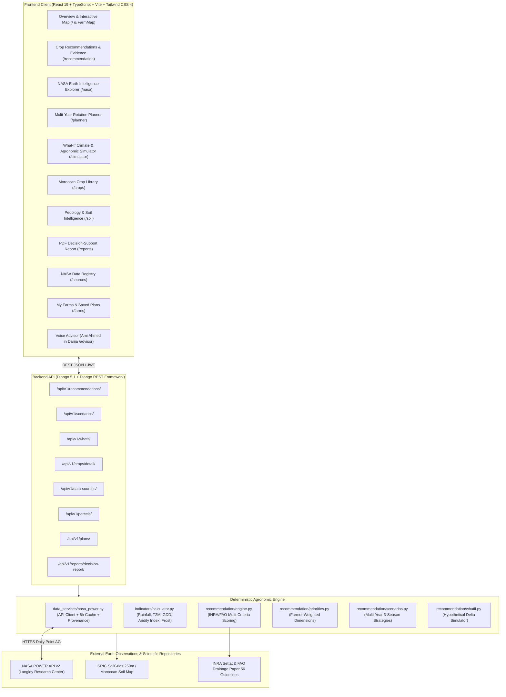

# TERRAROTA 🌱
> **NASA Space Apps Challenge 2026 • Challenge: Field Shift — Adapting Farms with NASA Data**  
> **Geographic Focus: Kingdom of Morocco**  
> *"TerraRota transforms NASA Earth observation data, local Moroccan soils, crop physiological requirements, and farmer priorities into explainable multi-year crop rotations that ensure climate resilience and food security in Morocco."*

---

## 🌟 Executive Summary

Moroccan agriculture is facing severe interconnected challenges: recurrent droughts, irregular precipitation patterns, depleted groundwater aquifers, and accelerating soil degradation caused by continuous cereal monoculture. Smallholder farmers often make planting choices without access to consolidated climate and soil intelligence.

**TerraRota** bridges the gap from NASA Earth observations down to actionable on-the-ground farming decisions by combining four pillars:
1. **NASA Earth Observations**: Live agroclimatology retrieved from the **NASA POWER** API (Langley Research Center), covering precipitation (`PRECTOTCORR`), temperatures (`T2M`, `T2M_MAX`, `T2M_MIN`), Growing Degree Days (`GDD`), and UNEP Aridity Index over a 5-year climatological window.
2. **Moroccan Soil Intelligence**: Classification of traditional Moroccan pedological classes (**Tirs**, **Hamri**, **Rmel**, **Dahra**) cross-referenced with ISRIC SoilGrids 250m digital models.
3. **Scientific Agronomic Rules**: Homologated crop rotation guidelines from **INRA Maroc** (Institut National de la Recherche Agronomique), **ICARDA**, and **FAO**, quantifying biological nitrogen fixation (40 to 100 kg pure N/ha) by food pulses following cereals.
4. **Farmer-Controlled Decision Support**: A deterministic recommendation engine proposing 3-year rotation scenarios, interactive What-If climate simulations, printable PDF decision reports, and voice guidance in **Moroccan Arabic (Darija)**, **French**, and **English**.

---

## 🏛️ System Architecture



---

## 🛰️ NASA Earth Observation Integration

TerraRota does not use static placeholders; NASA observations play a real, deterministic role in every calculation:

| NASA Product / Parameter | Code | Role in TerraRota | Agronomic Threshold Applied |
|---|:---:|---|---|
| **Corrected Precipitation** | `PRECTOTCORR` | Multi-year annual rainfall climatology & seasonal distribution | Cereal viability (>300 mm), Legume flowering (>250 mm), Aridity classification |
| **Mean Air Temperature (2m)** | `T2M` | Base temperature for growth & biological activity | Evapotranspiration estimation & heat tolerance screening |
| **Temperature Extremes** | `T2M_MAX`, `T2M_MIN` | Frost-risk evaluation & heat stress detection | Days with $T_{min} < 0^\circ\text{C}$ to alert early flowering legumes (chickpea/almond) |
| **Growing Degree Days** | `GDD Base 10°C` | Phenological maturity accumulation | Hard wheat ($\ge 1200$ GDD), Soft wheat ($\ge 1100$ GDD), Tomato ($\ge 1800$ GDD) |
| **UNEP Aridity Index** | `P / PET` | Ratio of precipitation to potential evapotranspiration | Hyper-arid ($<0.05$), Arid ($0.05-0.2$), Semi-Arid ($0.2-0.5$), Sub-Humid ($>0.5$) |
| **Solar Radiation** | `ALLSKY_SFC_SW_DWN` | Photosynthetic irradiance assessment | Olive and argan stomatal regulation models |

### Traceability Chain
Every recommendation displays the full audit trail:
$$\text{NASA Satellite (POWER AG)} \longrightarrow \text{Agrometeorological Indicator} \longrightarrow \text{INRA / FAO Rule} \longrightarrow \text{Farmer Decision}$$

*Zero fabricated data policy: If NASA is unreachable, the system uses a certified historical snapshot and explicitly flags the provenance state.*

---

## 🌾 Moroccan Crop Catalogue (12 Homologated Species)

1. **Durum Wheat (`wheat_hard`)** — *Triticum durum* • Rainfed staple, high N requirement.
2. **Soft Wheat (`wheat_soft`)** — *Triticum aestivum* • Bread wheat, moderate water demand.
3. **Barley (`barley`)** — *Hordeum vulgare* • Drought-hardy cereal, superior water-use efficiency (WUE).
4. **Chickpea (`chickpea`)** — *Cicer arietinum* • Symbiotic N-fixation (40-80 kg N/ha), root disease breaker.
5. **Faba Bean (`faba_bean`)** — *Vicia faba* • High biomass & soil regenerator (up to 100 kg N/ha).
6. **Lentil (`lentil`)** — *Lens culinaris* • Dryland pulse, early maturity, low water consumption.
7. **Olive Tree (`olive`)** — *Olea europaea* • Perennial drought-tolerant tree crop.
8. **Argan Tree (`argan`)** — *Argania spinosa* • Endemic southwest Morocco, deep taproot system.
9. **Almond Tree (`almond`)** — *Prunus dulcis* • Mediterranean dryland tree crop.
10. **Tomato (`tomato`)** — *Solanum lycopersicum* • High-value market crop under drip irrigation.
11. **Potato (`potato`)** — *Solanum tuberosum* • Intensive cash crop, water-demanding.
12. **Cactus Pear (`cactus_pear`)** — *Opuntia ficus-indica* • CAM photosynthesis, extreme drought resilience.

---

## 📋 Multi-Year Rotation Scenarios & What-If Simulator

Rather than dictating a single rigid crop, TerraRota dynamically generates **multi-year rotation strategies**:
- **Biological Soil Regeneration (Légumineuse - Céréale)**: Integrates nitrogen-fixing pulses to restore organic matter without synthetic fertilizer costs.
- **Water Conservation & Drought Resilience**: Maximizes drought-tolerant species (Barley, Olive, Cactus) with over 25-50% water savings.
- **High Economic Market Value**: Targets cash crops under monitored drip water allocation.
- **Balanced & Sustainable**: Rotates distinct botanical families to spread climate and market risks.

### What-If Scenario Simulator
Farmers can interactively test hypothetical conditions:
- *"What if annual rainfall drops by 20% or 30%?"*
- *"What if average temperatures increase by +1.5°C?"*
- *"What if I switch from rainfed to drip irrigation?"*
- *"What if I prioritize soil health over immediate short-term profit?"*

The engine calculates the live delta and displays before-and-after affinity score transitions.

---

## 🌐 Trilingual Accessibility & Agentic Voice Advisor

- **100% Trilingual Parity**: Full instant switching between **Moroccan Arabic (العربية - RTL)**, **French (Français)**, and **English**.
- **Agentic AI Agricultural Advisor ("Ami Ahmed" & "Mi Fatima")**:
  - Full-duplex conversational voice call (`VoiceCallScreen.tsx`) powered by high-definition Moroccan neural voices (**Ami Ahmed 👨‍🌾** via `ar-MA-JamalNeural` and **Mi Fatima 👩‍🌾** via `ar-MA-MounaNeural`).
  - **Autonomous Plan Actions**: Farmers can speak directly in Moroccan Darija to inspect their land or link recommended crops to their official plan (e.g. *"صافي غير ربطها بالخطة الرسمية"* / *"peux-tu insérer cela dans mon plan"*), generating human-confirmed `FarmPlan` updates.
  - Natural voice barge-in with speech streaming and an adaptive 2.2s silence detection timer.
- **Interactive Morocco Leaflet Map**: Direct GPS coordinate selection across all Moroccan agricultural provinces.
- **One-Click Farm Save & Plan Approval**: Saved parcels and approved rotation plans persist in the database and appear in **"Saved Farms & Plans"** (`/farms`).
- **Official PDF Report Generator**: Instant download of official decision-support reports citing NASA, INRA, and FAO.

---

## 🚀 Quick Start & Installation

### Prerequisites
- Python 3.11+ (Python 3.13 supported)
- Node.js 18+ & npm
- Git

### 1. Clone the repository
```bash
git clone https://github.com/medchetoui/TerraRota.git
cd TerraRota
```

### 2. Configure & Run Backend
```powershell
# In terminal 1:
python -m pip install -r requirements.txt
python backend/manage.py migrate
python backend/manage.py runserver 127.0.0.1:8000
```
*API available at: `http://127.0.0.1:8000/api/v1/`*

### 3. Configure & Run Frontend
```powershell
# In terminal 2:
cd frontend
npm install
npm run dev
```
*Web interface available at: `http://localhost:5173/`*

---

## 🧪 Test Suite & Quality Assurance

TerraRota incorporates an automated test suite verifying data integrity, error boundaries, and deterministic scoring:

```powershell
# Run backend test suite (101 automated tests across agronomy, NASA indicators, and AI advisor)
pytest backend/ -v
# Result: 101 passed in ~12s (100% pass rate)

# Verify TypeScript compilation and production build
cd frontend
npm run build
# Result: built in ~1.1s with 0 errors
```

---

## 👥 Team Collaboration (NASA Space Apps Challenge 2026)

Developed by a multidisciplinary team. Roles, responsibilities, and technical work packages are documented in [`docs/TEAM_CONTRIBUTIONS.md`](./docs/TEAM_CONTRIBUTIONS.md).

---

## 📜 Scientific References & Acknowledgments

- **NASA POWER Project**: NASA Langley Research Center, Agroclimatology Methodology v2.0.
- **INRA Maroc**: Institut National de la Recherche Agronomique — *Bulletins sur les systèmes de rotation céréale-légumineuse en zone semi-aride*.
- **FAO**: Food and Agriculture Organization — *Irrigation and Drainage Paper 56: Crop Evapotranspiration* & *Dryland Agriculture Series*.
- **ICARDA**: International Center for Agricultural Research in the Dry Areas — *Biological Nitrogen Fixation and Legumes in Mediterranean Rainfed Agriculture*.
- **ISRIC / World Soil Information**: *SoilGrids 250m Global Gridded Soil Profile Database*.

---

## 📄 License

This project is licensed under the MIT License — see the LICENSE file for details.  
All satellite observations are provided courtesy of the NASA Earth Science Division / NASA POWER Project.
