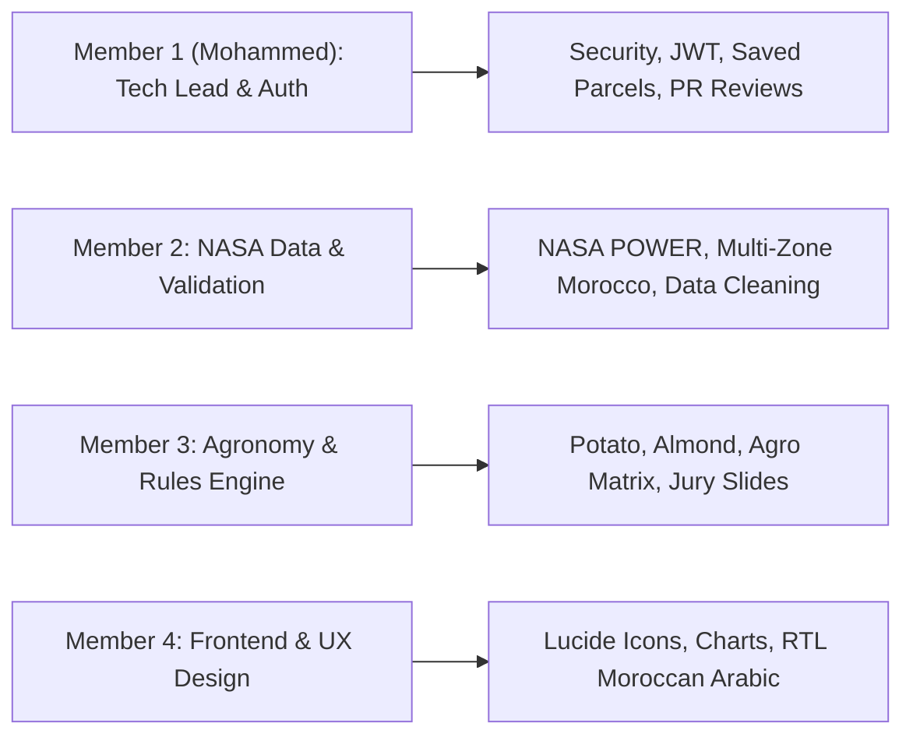

# Roadmap & Task Distribution — TerraRota (Hackathon 24–28 Oct)

> 🎯 **Objectif :** Livrer un produit complet, testé, sécurisé et prêt pour la présentation devant le Jury le **28 Octobre**.

---

## 👥 Répartition des 4 Membres



---

### 👤 Member 1 — Mohammed (Tech Lead / Backend Architecture & Security)
**Responsabilités principales :**
1. **Sécurité & Auth :**
   - Endpoints JWT opérationnels (`/api/v1/auth/register/`, `/api/v1/auth/login/`, `/api/v1/auth/me/`).
   - Modèle de données `Parcel` pour la sauvegarde des parcelles par utilisateur.
   - Gestion des tokens et autorisations Bearer.
2. **Intégration & DevOps :**
   - Orchestration du dépôt Git (`main` protégée, revues des branches).
   - Validation que `pytest tests.py` reste à 100% vert (actuellement 43/43).
   - Préparation du déploiement ou du pack de démo locale.

**Fichiers clés :**
- `backend/terrarota/settings.py`
- `backend/api/views.py` & `backend/api/urls.py`
- `backend/fields/models.py`
- `backend/tests.py`

---

### 👤 Member 2 — Data Specialist (NASA Earth Observation Data)
**Responsabilités principales :**
1. **Validation multi-zones au Maroc :**
   - Tester et documenter les réponses de NASA POWER sur 4 pôles agricoles clés :
     - **Marrakech (Haouz)** : Aride / semi-aride (Bour)
     - **Agadir (Souss-Massa)** : Climat chaud, zone de l'arganier
     - **Fès / Meknès (Saïss)** : Zone céréalière & arboricole pluviale
     - **Kénitra (Gharb)** : Zone irriguée, maraîchère
2. **Robustesse de la donnée :**
   - Vérifier le filtrage des valeurs manquantes (`-999`).
   - Documenter la résolution spatiale (~50 km) et pourquoi TerraRota utilise une maille satellite régionale.
   - *(Optionnel / Bonus Jury)* : Rédiger une note sur l'intégration future de **NASA SMAP** (humidité du sol).

**Commandes utiles :**
```powershell
# Vérifier la connexion NASA en direct
python backend/scripts/check_nasa.py
```

---

### 👤 Member 3 — Agronomist & Algorithm Specialist (Agronomie & Règles)
**Responsabilités principales :**
1. **Enrichissement du catalogue de cultures :**
   - Déjà intégré : **Pomme de terre (البطاطا)** et **Amandier (اللوز)** en plus des 8 cultures initiales.
   - Nouvelles cultures à évaluer si besoin : Maïs, Agrumes (Citrus), Dattiers (Phoenix dactylifera).
2. **Validation des seuils scientifiques :**
   - Vérifier les seuils de GDD, de pluie et de résistance au gel avec des données marocaines (références : INRA Maroc, IAV Hassan II, FAO).
   - Valider la matrice de rotation culturale (ex: blé -> légumineuse / pois chiche -> pomme de terre).
3. **Préparation du Pitch scientifique :**
   - Préparer les diapositives expliquant pourquoi le moteur est **déterministe et transparent** (pas une boîte noire LLM) : le Jury adore la rigueur scientifique.

**Fichiers clés :**
- `backend/recommendation/rules.py`
- `docs/AGRONOMIC_RULES.md`

---

### 👤 Member 4 — Frontend & UX Designer (React / Vite)
**Responsabilités principales :**
1. **Design System "Pure & Modern Agro-Tech" :**
   - 0 Emojis : Utilisation exclusive de la librairie **Lucide Icons** (`lucide-react`).
   - Interface sombre ultra-moderne, badges contrastés et lisibles.
2. **Parcours Utilisateur Complet :**
   - Modale d'authentification (Connexion / Inscription).
   - Sauvegarde et chargement direct des parcelles sauvegardées.
   - Visualisation des indicateurs satellitaires (GDD, précipitations, jours de gel).
3. **Support RTL Darija / Arabe :**
   - S'assurer que le mode Arabe (`lang === 'ar'`) est parfait pour un agriculteur ou conseiller marocain.
4. **Captures d'écran & Démo :**
   - Réaliser un enregistrement vidéo fluide du parcours utilisateur complet pour le pitch.

**Commandes utiles :**
```powershell
cd frontend
npm run dev
npm run build
```

---

## 🗓️ Calendrier Sprint (24 au 28 Octobre)

| Date | Milestone | Responsable |
|---|---|---|
| **24 Octobre** | ✅ JWT Auth, Modèle Parcelles, Ajout Pomme de Terre & Amandier, UI sans emojis | Mohammed & Claude |
| **25 Octobre** | Validation NASA 4 zones marocaines + Ajustement seuils agronomiques | Member 2 & Member 3 |
| **26 Octobre** | Peaufinage frontend + Relecture de l'arabe/français + Tests unitaires | Member 4 & Member 1 |
| **27 Octobre** | Répétition générale du Demo Flow + Rédaction des slides de pitch | Toute l'équipe |
| **28 Octobre** | **SOUMISSION & PRÉSENTATION FINALE DEVANT LE JURY** 🚀 | Toute l'équipe |
